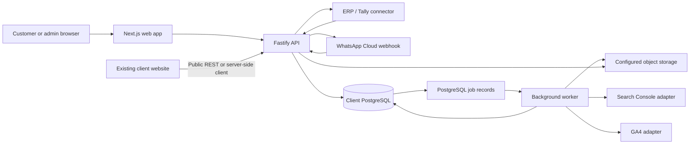
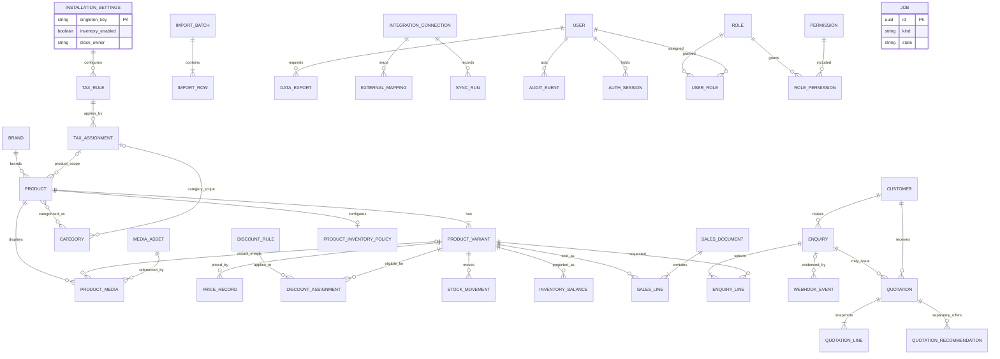

# Palnadu.dev Smart Pricing — Initial Architecture and Requirements

- **Status:** Architecture proposal with recorded owner approvals; Phase 2
  database/backend foundation authorized, other feature and production work
  remains gated by the decision register
- **Audit date:** 2026-11-14
- **Tracking:** [Issue #2](https://github.com/esparexin/palnadu-smart-pricing-/issues/2)
- **Governance:** [`docs/standards/ENGINEERING_GOVERNANCE.md`](../standards/ENGINEERING_GOVERNANCE.md)

This specification records an architecture proposal and the evidence available at
the time of the audit. It is not evidence that any application, test, CI workflow,
deployment, security control, or browser validation exists. Do not begin feature
implementation until the project owner reviews and explicitly approves this
specification. The owner has since authorized the bounded Phase 2 foundation;
that scope approval does not approve unresolved business decisions or authorize
later feature or production work.

## 1. Repository audit

### 1.1 Observed state

| Item                               | Finding                                                                                                                             |
| ---------------------------------- | ----------------------------------------------------------------------------------------------------------------------------------- |
| Repository                         | `esparexin/palnadu-smart-pricing-`                                                                                                  |
| Local path                         | `~/Desktop/palnadu-smart-pricing-`                                                                                                  |
| Current branch                     | `docs/architecture-audit`                                                                                                           |
| Current commit                     | None; the branch has no commits and therefore no HEAD commit to cite                                                                |
| Remote                             | `origin` fetch and push both point to `https://github.com/esparexin/palnadu-smart-pricing-.git`                                     |
| Remote branches                    | `git ls-remote --heads origin` returned no branch refs                                                                              |
| GitHub default branch              | Not established; repository metadata returned an empty default-branch name                                                          |
| Main branch protection             | Could not be inspected: GitHub returned 404 because `main` does not exist                                                           |
| GitHub visibility                  | Public                                                                                                                              |
| Working tree                       | Untracked `.DS_Store` and `docs/`; no tracked files or commits                                                                      |
| Applicable repository instructions | No root-level or in-repository `AGENTS.md` or other instruction file was found                                                      |
| Initial files found                | `docs/standards/ENGINEERING_GOVERNANCE.md`, plus macOS `.DS_Store` metadata files                                                   |
| Current planning artifacts         | `docs/architecture/INITIAL_ARCHITECTURE.md` and `docs/architecture/DECISION_REGISTER.md` are uncommitted documentation deliverables |
| Application/tooling                | No application source, package manifests, dependencies, scripts, lockfiles, tests, workflows, or deployment files found             |

The `.DS_Store` files were left untouched. The architecture and decision
documents in this worktree are planning deliverables, not application
implementation. No branch, repository, production, or application settings
were changed.

### 1.2 Governance and GitHub delivery backlog

The complete 18-section governance file was read. It is mandatory and remains
the repository's authoritative engineering baseline. The GitHub issue list and
bodies for open issues #1–#19 were inspected. Issue #2 is the active audit gate;
it requires explicit owner approval before coding.

The delivery backlog establishes these frozen decisions:

- Deliver a complete standalone Smart Pricing application first. Clients can
  also integrate existing websites without rebuilding them.
- Each client installation owns its database, products, prices, customers,
  quotations, credentials, admin users, media configuration, and integrations;
  this is not a centralized multi-tenant runtime.
- Products can be entered manually and imported/exported through Excel/CSV.
  Catalogues may contain hundreds or thousands of products.
- Inventory is optional. When Smart Pricing owns enabled inventory, the default
  minimum-stock threshold is 1 unit and can be overridden globally or by product.
  Low-stock, critical-stock, and out-of-stock states are distinct.
- Inventory stock ownership must be explicit: Smart Pricing or an external ERP.
- Low-stock alerts are distinct from sales velocity. Fast-/slow-moving analysis
  uses actual invoice/dispatch sales, never views, clicks, or quotations.
- Image discovery is hybrid: manufacturer sources, authorized distributor feeds,
  then commercial-licensed/other sources with documented rights. Google and
  other search engines are discovery channels, not evidence of free commercial
  usage. Brand/model matching, candidate review, and rights approval are required
  before publication.
- TallyPrime and other systems use replaceable connectors. Do not expose local
  Tally ports to the public internet; assess a secure local connector.
- The proposed starting stack is TypeScript, pnpm, Next.js, Node.js, Fastify,
  PostgreSQL, Drizzle ORM, Zod, R2 initially with S3-compatible support, Sharp,
  and PostgreSQL-backed jobs. Redis is deferred until measured need justifies it.
- Public surfaces must not reveal hidden MRP, offer, or discount values.
- Pricing and quotation calculations are server-authoritative; issued quotations
  retain immutable historical snapshots.
- Recommendations, advanced analytics, unified inbox, payments, shipping, and
  other social channels are not launch blockers unless separately approved.

The current owner review additionally requires explicit evaluation of Pino,
Vitest, Playwright, and GitHub Actions, as well as client-owned WhatsApp Business
Cloud API, Google Search Console, and GA4 integrations. These are assessed as
proposed logging/testing/CI and integration capabilities below; they do not
silently become installed dependencies or launch blockers.

All delivery issues are open. The epic and issue #2 explicitly say that backlog
creation does not authorize implementation. The issue sequence is the roadmap
baseline in section 14 below.

## 2. Scope, assumptions, and decision status

### 2.1 Scope

The proposed product supports standalone client installations for product
catalogue and administration, private pricing, optional inventory, customer
enquiries, quotations, approved product imagery, bulk product workflows, and
replaceable ERP/billing integrations. It also exposes controlled integration
surfaces so existing client websites and external business systems can consume
approved functionality without being rebuilt.

This document defines target requirements and architecture, not current
functionality. It does not authorize production provisioning, paid services,
external account changes, deployments, package publishing, or application
scaffolding.

### 2.2 Decisions this draft treats as backlog-approved

Only the frozen decisions in section 1.2 are treated as agreed. In particular,
the proposed stack is not represented as a decision to install dependencies or
select hosting. Product and stock ownership are configurable per entity/system,
not inferred from whichever source last wrote a value.

### 2.3 Architecture proposals requiring review

1. Use a TypeScript modular monolith with clear domain and adapter boundaries.
   Initially deploy the public/admin web app, API, and background worker as
   separate processes from one repository and one release train.
2. Use one Next.js application with public and admin route groups; do not create
   separate frontends unless an actual deployment or security boundary requires
   them.
3. Use Fastify as the application API, with versioned HTTP contracts and an
   OpenAPI description derived from the canonical schemas.
4. Start with one PostgreSQL database per client installation. Do not add a
   `tenant_id` tenancy layer to this independent-installation product.
5. Start with PostgreSQL-backed job claiming and retry-safe handlers. Defer
   Redis, a message broker, and microservices until measured capacity or
   reliability needs justify the operational cost.
6. Put external capabilities behind domain-owned ports. Add adapter packages
   only when the corresponding integration is being delivered.
7. Deliver the standalone storefront/admin first, while providing versioned
   REST interfaces and documented external adapters for existing websites and
   business systems. A client website must not need to be rebuilt.
8. Keep public product reads structurally unable to query or serialize private
   price fields. Keep pricing and quotation services server-side.

## 3. Application architecture

### 3.1 Topology



The diagram is a target proposal, not a deployed topology. The standalone
Next.js storefront and admin are first-class applications. An existing client
website can consume documented REST APIs or a server-side integration client;
it need not be rebuilt. Optional embedded/presentation integration is a separate
decision and must use the same public-safe contracts. Public product pages may
be rendered/indexed by Next.js, but product data must come from the public-safe
application interface. The API remains the authority for business rules,
authorization, persistence, webhook processing, and private prices.

### 3.2 Runtime responsibilities

- **Web (`apps/web`, proposed):** public catalogue and admin presentation,
  accessible navigation and forms, session-aware admin routes, and presentation
  state only. It must not own business calculations or direct database access.
- **API (`apps/api`, proposed):** Fastify composition root; request validation;
  authentication/authorization; application-use-case invocation; transaction
  boundaries; OpenAPI and error contracts; rate limits; and provider webhooks.
- **Worker (`apps/worker`, proposed):** bounded, retry-safe import, image
  processing/discovery, document generation, and integration sync jobs. It
  invokes the same application services used by synchronous requests.
- **PostgreSQL:** transactional source of truth for catalogue, price, optional
  owned inventory, enquiries, quotations, user authorization, audit, import
  records, integration metadata, and job state.
- **Object storage:** binary originals and derivatives only. PostgreSQL stores
  object keys and metadata, not image/PDF binaries. R2 is the initial proposed
  provider; S3 compatibility is an adapter capability, not a second source of
  truth.

### 3.3 Dependency direction

```text
apps/web ───────> browser-safe contracts
apps/web ──HTTP─> apps/api
apps/api ───────> application + contracts + persistence + server configuration
apps/worker ────> application + contracts + persistence + server configuration
application ────> domain + contracts + domain-owned ports
domain ─────────> domain-owned ports and standard library only
contracts ──────> canonical Zod schemas and contract types
persistence ────> domain ports + Drizzle + PostgreSQL driver
provider adapters -> domain ports + provider SDKs / HTTP clients
```

Core business logic must not depend on Next.js, React, Fastify, PostgreSQL,
Drizzle, browser APIs, Meta SDKs, or a specific storage/ERP provider.
Controllers call application services; repositories and provider adapters are
injected at composition boundaries. Do not share server-only secrets or modules
with browser bundles.

### 3.4 Proposed stack assessment

The table evaluates suitability; it does not authorize installing or pinning
dependencies. Final versions and license/security review belong to the approved
repository-foundation phase.

| Layer                      | Assessment                                                         | Main caveat / control                                                                                                                                                                                       |
| -------------------------- | ------------------------------------------------------------------ | ----------------------------------------------------------------------------------------------------------------------------------------------------------------------------------------------------------- |
| TypeScript                 | Suitable across web, API, worker, contracts, and adapters          | Enable strict settings; browser/server package boundaries must be checked                                                                                                                                   |
| pnpm                       | Suitable for a small workspace sharing contracts/domain code       | Workspace is justified only if actual packages have responsibilities; commit one lockfile and pin runtime/package-manager versions                                                                          |
| Next.js                    | Suitable for crawlable server-rendered public pages and admin UI   | Use Node-compatible deployment for server features; avoid duplicating business API logic in Next route handlers                                                                                             |
| Node.js + Fastify          | Suitable for versioned REST APIs, webhooks, and long-lived workers | Separate web/API processes add deployment and session complexity; justified by required external REST integrations, webhooks, and worker lifecycle                                                          |
| PostgreSQL                 | Suitable transactional per-installation source of truth            | Managed provider/region, connection limits, backups, restore, and migration roles remain undecided                                                                                                          |
| Drizzle ORM                | Suitable typed SQL and migration workflow                          | Still requires an explicit PostgreSQL driver/pool, migration runner, constraint strategy, and review of generated SQL                                                                                       |
| Zod                        | Suitable canonical runtime request/contract validation             | OpenAPI generation and Fastify integration require one compatible adapter/tool; share browser schemas only where useful, never ship server-only schemas/secrets or treat client validation as authoritative |
| R2 + S3-compatible adapter | Suitable initial object-storage direction                          | S3 compatibility is not identical behavior; test signing, multipart, metadata, lifecycle, ACL/public delivery, and provider-specific errors                                                                 |
| Sharp                      | Suitable server-side image normalization and derivatives           | Native binaries require a compatible Node/container build; bound pixel dimensions, memory, concurrency, and decompression risk                                                                              |
| PostgreSQL-backed jobs     | Appropriate initial queue for modest independent installations     | Use leases/atomic claims, retry/idempotency and cleanup; monitor database contention, table bloat, and queue lag                                                                                            |
| Redis                      | Correctly deferred                                                 | Add only after measured queue/cache need and a documented operational/availability justification                                                                                                            |
| Pino                       | Suitable structured logging; Fastify already integrates with Pino  | Reuse one configured logger with secret/PII redaction; do not add a competing logging pipeline                                                                                                              |
| Vitest                     | Suitable TypeScript unit/contract testing                          | Select one runner and coverage provider; integration tests need isolated PostgreSQL                                                                                                                         |
| Playwright                 | Suitable real browser E2E and viewport checks                      | CI must provision browsers and retain failure screenshots/traces; real responsive evidence is still required                                                                                                |
| GitHub Actions             | Suitable PR automation after a default branch is established       | Repository currently has no default branch or workflow; secrets/environments and required checks need owner administration                                                                                  |

#### Required supporting capabilities not yet selected

Before feature implementation, select and document only the dependencies
needed for the approved scope:

- Drizzle-compatible PostgreSQL driver and bounded connection pool; migration
  execution/rollback procedure.
- Fastify/Zod adapter and OpenAPI generation approach; cookie/session store,
  CSRF, rate-limit, CORS, security-header, and multipart/file-size controls.
- Password hashing and recovery mechanism if local passwords are chosen.
- CSV and XLSX streaming parse/export libraries, reviewed for maintenance,
  security, and license; XLSX must not require loading unbounded workbooks into
  memory.
- R2/S3 client and upload strategy; provider-specific behavior must be isolated.
- A PDF/document renderer for quotations, chosen after output, font,
  accessibility, and runtime constraints are defined.
- Vitest coverage provider and Playwright browser/CI setup.
- Optional Search Console/GA4 client or API adapters, with per-client scopes,
  credential storage, consent/privacy, and data-retention rules.
- Metrics/alerting/exporter capability if operational scale requires it; Pino
  logs alone do not provide metrics, tracing, or alerting.

WhatsApp Cloud API and other HTTP services can be integrated through documented
HTTP ports; a provider SDK is not mandatory unless its support and security
benefits are demonstrated.

#### Deployment, complexity, and cost implications

This stack targets a standard Node.js container/VM environment with PostgreSQL
and outbound HTTPS. An edge-only/serverless runtime should not be selected
without verifying Fastify lifecycle, Sharp native support, long-lived workers,
webhook delivery, database connection limits, and job execution constraints.
Do not expose a PostgreSQL-backed worker as a short-lived request handler.
Prefer a same-origin reverse proxy for the standalone web/API where practical;
external client websites use explicit CORS only for public endpoints and
server-side credentials for private integrations. Avoid browser-held API
secrets.

Separate Next.js, API, and worker processes improve lifecycle and security
boundaries but increase deployment, monitoring, and per-installation operating
cost. Expected cost drivers include managed PostgreSQL compute/storage/backup,
web/API/worker compute, object storage operations and delivery, image discovery
providers, WhatsApp messaging, domains/TLS where charged, logs/metrics, backups,
and CI browser runs. Provider, region, traffic, retention, support, and service
limits are not selected; no price estimate or paid service is implied here.
Independent installations multiply baseline operations and require per-client
backup, secret, credential, and upgrade ownership.

## 4. Application and package boundaries

These are proposed responsibilities, not directories to create now. Create a
package only when an implemented responsibility needs it; do not create empty
or speculative packages.

| Boundary                 | Responsibility                                                                                                          | Must not own                                                |
| ------------------------ | ----------------------------------------------------------------------------------------------------------------------- | ----------------------------------------------------------- |
| `apps/web`               | Next.js public/admin routes, presentation, accessibility and client interaction                                         | Pricing rules, persistence, ERP logic, private secrets      |
| `apps/api`               | Fastify routes, auth middleware, use-case composition, OpenAPI, HTTP error mapping                                      | Duplicated domain rules or direct UI concerns               |
| `apps/worker`            | Job polling, worker lifecycle, retries and scheduling                                                                   | A second implementation of application operations           |
| `packages/contracts`     | Canonical request/response/event schemas, Zod validation, public-safe DTOs and API contract types                       | Database models or business calculation implementations     |
| `packages/domain`        | Product/pricing/quotation/inventory/import/enquiry rules, domain types and ports                                        | Framework, ORM, provider SDK, HTTP request/response objects |
| `packages/application`   | Use-case orchestration shared by API and worker, authorization-aware operations, transaction coordination through ports | HTTP transport, ORM queries or duplicate business rules     |
| `packages/persistence`   | Drizzle schema and migrations, repository implementations, transactions and database health                             | UI DTOs or independent business rules                       |
| `packages/server-config` | Central validated server environment and installation configuration access                                              | Public browser settings or duplicated defaults              |
| Provider adapter modules | Storage, WhatsApp, image discovery, ERP/Tally, Search Console, and GA4 translation to documented ports                  | Authoritative client data or alternate business rules       |

The first implementation should use the smallest package set that can preserve
these boundaries. In particular, keep imports and shared validation in one
contract source of truth. Do not split domain packages by feature until
independence, ownership, or build isolation makes that worthwhile.

## 5. Domain boundaries and requirements traceability

The domain layer owns invariant rules. The application layer coordinates
transactions and authorization; adapters implement persistence and external
protocols; the web layer presents responses. Contracts describe validated
inputs/outputs and are reused rather than re-created in each app.

| ID / capability                              | Owning domain and contract                                              | API boundary                                                           | Data owner                                                                        | UI workflow                                                            | Dependencies                                                     | Acceptance evidence                                                                                                                                                                 |
| -------------------------------------------- | ----------------------------------------------------------------------- | ---------------------------------------------------------------------- | --------------------------------------------------------------------------------- | ---------------------------------------------------------------------- | ---------------------------------------------------------------- | ----------------------------------------------------------------------------------------------------------------------------------------------------------------------------------- |
| CAT-1 Manual catalogue                       | Catalogue; product, brand, category, model/part number, variant schemas | Admin product/category CRUD                                            | Smart Pricing or configured product-master ERP                                    | Admin create/edit/archive/search                                       | IAM-1; data/API foundation                                       | Authorized admin can create, edit, archive, and search; duplicate SKU is rejected; brand/model/part number search is covered; unauthorized writes fail                              |
| CAT-2 Public catalogue                       | Catalogue; public-safe product DTO                                      | Public list/detail/search                                              | Product-master owner                                                              | Browse, filter, product detail                                         | CAT-1; MED-1                                                     | Public API and rendered source contain no price fields; pagination and empty/error states work                                                                                      |
| IMP-1 Bulk import/export                     | Import/export; versioned row, template, and export schemas              | Upload, preview, confirm, status/result, authorized export             | Smart Pricing catalogue; explicit update mode                                     | Template, preview, row errors, progress/history, export options        | CAT-1; IAM-1; OPS-1                                              | CSV/XLSX create/update, retry, and exported data tests cover 100, 500, 1,000, and larger catalogues; row errors identify row/field/reason; ordinary imports do not change stock     |
| MED-1 Product media                          | Media; upload and metadata schemas                                      | Upload/order/replace/remove                                            | Object store owns bytes; PostgreSQL owns metadata/reference                       | Individual and bulk product image management                           | CAT-1; IAM-1                                                     | Invalid files and unauthorized mutations are rejected; multiple images, ordering, and replacement persist consistently                                                              |
| IMG-1 Image discovery                        | Discovery; candidate/licence/review contracts                           | Search, review, approve/reject                                         | Provider supplies candidate; admin owns publication decision                      | Multiple candidate review queue                                        | MED-1; OPS-1                                                     | Manufacturer/distributor/provider order and model-match evidence are recorded; Google is discovery only; no unapproved candidate publishes; reject/retry preserves approved images  |
| PRC-1 Pricing                                | Pricing; admin price/discount contracts; private DTO                    | Admin-only price operations                                            | Smart Pricing price book unless explicitly mapped otherwise                       | Admin price/discount forms                                             | CAT-1; IAM-1                                                     | Server-calculated totals match approved boundary/rounding cases; expired/invalid prices fail; public leakage scan finds no price                                                    |
| TAX-1 Tax configuration                      | Tax/quotation; effective tax rule and snapshot contracts                | Admin-only tax configuration after D-01 approval                       | Installation's approved tax policy                                                | Admin setup and quotation preview                                      | PRC-1; D-01                                                      | Approved jurisdiction/tax examples calculate and round correctly; issued line and quote totals preserve tax snapshots                                                               |
| INV-1 Inventory and alerts                   | Inventory; config/movement/balance/alert contracts                      | Admin stock operations and permitted read                              | Explicit Smart Pricing or ERP owner                                               | Optional stock screens, movements, low/critical/out-of-stock alerts    | CAT-1; ERP-1 when externally owned                               | Disabled mode requires no stock; local and ERP ownership tests prevent dual writes; low, critical, and zero-stock states follow approved thresholds; concurrent movements reconcile |
| SALE-1 Sales movement                        | Sales analytics; imported invoice/dispatch contracts                    | Authorized sync/import                                                 | Actual invoicing/dispatch source                                                  | Fast-/slow-moving report only when available                           | ERP-1 or approved actual-sales import                            | Reports derive only from eligible invoice/dispatch lines; duplicate documents are idempotent; views, clicks, and quotes are excluded                                                |
| ENQ-1 Enquiry                                | Enquiry; request/contact/product selection contracts                    | Explicit web submission if approved; verified channel events           | Smart Pricing owns minimal enquiry record                                         | WhatsApp handoff and/or approved web form                              | CAT-1; IAM-1                                                     | Opening WhatsApp creates no submitted record; only an approved explicit submission or verified event transitions to submitted/verified                                              |
| QUO-1 Quotation                              | Quotation; request/issued quote/snapshot contracts                      | Request, admin review/issue, history and download                      | Smart Pricing owns issued quote and immutable snapshot                            | Admin quote review and customer delivery                               | ENQ-1; PRC-1; TAX-1; IAM-1                                       | Issued quote values/PDF remain unchanged after product price edits; duplicate inbound events cannot issue duplicate quotes                                                          |
| MSG-1 WhatsApp Cloud API                     | Messaging adapter and signed event contract                             | Public signed webhook; authenticated send/status operations            | Client's own WhatsApp Business assets; Smart Pricing event metadata               | Clearly labelled action, delivery status, human handoff and opt-out    | ENQ-1; configured per-installation credentials                   | Invalid signature/replay is rejected; duplicate event has one effect; template/service-window and consent rules are followed; no cross-client credentials                           |
| ERP-1 Business connectors                    | Integration; provider-neutral mapping and sync contracts                | Admin configuration/status; worker sync                                | Per-entity configured authoritative source                                        | Configure, map, review conflicts, inspect sync log                     | IAM-1; OPS-1; ownership decision                                 | Sync is idempotent and auditable; conflicts are visible; no local Tally port is publicly exposed                                                                                    |
| WEB-1 Existing website integration           | Public integration contract and server-side client interface            | Versioned public REST API; server-side integration auth where required | Existing website owns its presentation; this installation owns Smart Pricing data | Standalone app first; integrate existing website without rebuilding it | CAT-2; API foundation                                            | Existing-site integration uses documented contracts and public-safe fields; no secret is required in browser code                                                                   |
| ANA-1 Search and web analytics               | Optional analytics adapter contracts                                    | Per-installation Search Console/GA4 connection and reporting           | Client's own Google properties; Smart Pricing owns only approved sync metadata    | Admin integration status/reporting                                     | IAM-1; OPS-1; owner privacy/consent decision                     | Credentials are installation-specific; no customer PII, hidden prices, or quotation data is sent; analytics are never sales evidence                                                |
| REC-1 Recommendations (not a launch blocker) | One centralized recommendation rule/engine and shared contract          | Admin configuration and public-safe recommendations only if enabled    | Product availability owner and admin priorities                                   | Separate recommendation area, never silently added to quote            | CAT-1; INV-1 when availability is required; owner scope approval | Excludes selected/unavailable/duplicate products, respects priority, and requires customer consent before quote addition                                                            |
| IAM-1 Admin access                           | Identity/access; session and permission contracts                       | Login/logout/session and protected routes                              | Installation's PostgreSQL                                                         | Login, session expiry, permission-aware navigation                     | API/config foundation                                            | Unauthenticated and unauthorized API tests fail safely; session/CSRF/rate-limit controls are verified                                                                               |
| OPS-1 Audit/config/jobs                      | Operations; health, job and audit records                               | Readiness/health and admin operations                                  | PostgreSQL; secrets manager for credentials                                       | Useful status/error states                                             | API/config foundation                                            | Logs redact secrets/PII; correlation IDs link operations; failed jobs are visible and idempotently retryable                                                                        |

Rows marked "if approved" must not be presented as confirmed user journeys.
The unresolved decisions in section 15 gate the affected contracts and rules.

## 6. PostgreSQL model, ERD, and data dictionary

### 6.1 Database rules

- One client installation uses a dedicated PostgreSQL database and credentials;
  no shared application database or cross-client identifier is assumed.
- Define foreign keys, uniqueness, check constraints, and indexes in migrations;
  transactions protect multi-record operations and concurrency-sensitive changes.
- Preserve issued quotation snapshots and audit events. Archive catalogue records
  instead of destructive deletion when references/history exist.
- Keep media bytes outside PostgreSQL. Do not place integration credentials in
  ordinary configuration or logs; store secret-manager references.
- Use explicit currency codes, decimal-safe arithmetic, documented rounding, and
  typed quantity/unit precision. Never use binary floating-point for money.
- Model effective dates and timestamps in UTC; use installation time zone only
  for presentation and explicitly defined business-day rules.
- Avoid duplicate authoritative copies. ERP mappings and sync checkpoints are
  references/projections, not a second uncontrolled product or stock master.

### 6.2 ERD (logical proposal)



This ERD describes proposed logical relationships, not existing database
objects or migration files. Each installation is the implicit ownership scope.

The Phase 2 implementation establishes only the approved standalone catalogue
tables: brands, categories, products, product-category links, and variants.
Pricing/tax, inventory, customer, enquiry, quotation, import/export,
integration, identity, and audit schemas remain unimplemented until their
existing feature decisions and phases permit them.

### 6.3 Data dictionary

The table names below are logical names. Exact SQL naming, enum strategy, and
normalization should be settled during approved schema design.

| Entity                                                       | Key attributes and constraints                                                                                                                   | Authoritative owner / lifecycle                                                         |
| ------------------------------------------------------------ | ------------------------------------------------------------------------------------------------------------------------------------------------ | --------------------------------------------------------------------------------------- |
| `installation_settings`                                      | One validated singleton; currency, locale/time zone, inventory enabled, stock owner, thresholds, branding/publication settings                   | Installation admin; one configuration SSOT, non-secret values only                      |
| `brand`                                                      | ID, unique normalized name, status                                                                                                               | Product-master owner; archive if referenced                                             |
| `category`                                                   | ID, unique normalized name/slug, optional parent, status/order                                                                                   | Product-master owner; prevent hierarchy cycles                                          |
| `product`                                                    | ID, brand reference, name, model/part number, descriptions/specifications, status, public slug, timestamps, optimistic version                   | Product-master owner; archive rather than delete after use                              |
| `product_category`                                           | Product/category keys, uniqueness per pair                                                                                                       | Catalogue relation; prevent duplicate assignment                                        |
| `product_variant`                                            | ID, product key, optional installation-unique normalized SKU, variant model/part number where applicable, unit, option attributes, active status | Product-master owner; one or more sellable variants per product                         |
| `product_inventory_policy`                                   | Product key, optional low/critical threshold overrides and version                                                                               | Installation inventory policy; applies only when inventory is enabled                   |
| `media_asset`                                                | ID, object key, safe media type, dimensions/size, checksum, derivatives, uploader, processing status                                             | PostgreSQL metadata; object storage owns bytes                                          |
| `product_media`                                              | Product/asset keys, optional variant key, display order, primary flag, alt text, publication approval                                            | Admin publication control; one primary image per intended scope                         |
| `image_candidate`                                            | Product/variant match evidence, provider/source URL, licence evidence, attribution, retrieval time, review state, reviewer                       | Discovery adapter proposes; authorized admin approves/rejects                           |
| `price_record`                                               | Variant, currency, MRP, offer amount, effective interval, status/version, actor                                                                  | Pricing service; effective records must not conflict for same variant/currency          |
| `discount_rule`                                              | Type (percentage/fixed), value, currency when fixed, eligibility, effective interval, status, priority                                           | Pricing service; validity, caps and stacking require explicit rule                      |
| `discount_assignment`                                        | Discount rule and eligible product/variant/category scope, unique scope key                                                                      | Pricing service; exact assignment model and precedence require approval                 |
| `tax_rule`, `tax_assignment`                                 | Approved tax code/rate, jurisdiction and effective period; assignment scope and inclusive/exclusive mode only as approved                        | Installation tax configuration; exact jurisdiction/formula is gated by D-01             |
| `inventory_movement`                                         | Variant, optional approved location, signed quantity, reason/source, external reference, actor, time, idempotency key                            | Smart Pricing only when configured as stock owner; immutable movement history           |
| `inventory_balance`                                          | Variant, optional approved location, available/reserved quantities, version, updated time                                                        | Transactional projection of movements when owned locally; rebuildable/auditable         |
| `inventory_alert`                                            | Variant, alert class (low/critical/out-of-stock), threshold snapshot, state, notified/cleared times                                              | Inventory service; deduplicated state derived from authoritative stock                  |
| `sales_document`                                             | Source, external ID, document type/status, occurred time, idempotency key                                                                        | Billing/dispatch source; records actual eligible sales, not quotations                  |
| `sales_line`                                                 | Document, variant mapping, actual quantity, unit, net sales facts needed for analysis                                                            | Derived/imported from actual sales documents; preserve source reference                 |
| `customer`                                                   | ID and minimal normalized contact details, consent/opt-out metadata, retention marker                                                            | Installation; collect only fields needed for enquiry/quote                              |
| `enquiry`                                                    | ID/reference, customer, channel, status, consent, received/verified time, correlation key                                                        | Smart Pricing captures verified submissions/events; lifecycle/retention policy required |
| `enquiry_line`                                               | Enquiry, variant, requested quantity/unit, customer-approved selection                                                                           | Enquiry snapshot; no price exposed in public request                                    |
| `webhook_event`                                              | Provider, unique provider event ID, signature result, received/processed state, optional enquiry/quote reference, minimal redacted metadata      | Adapter event ledger; unique key prevents duplicate processing                          |
| `quotation`                                                  | Unique installation quote number, customer, source enquiry, status, currency, validity, terms, totals and issue time                             | Quotation service; draft/request distinct from issued document                          |
| `quotation_line`                                             | Quote, product/variant identity and display snapshot, quantity, MRP/offer/discount/tax/net snapshots and totals                                  | Immutable after issue; regenerated document must use this snapshot                      |
| `quotation_recommendation`                                   | Quote, separately offered variant, reason/priority and consent state                                                                             | Not part of quote totals until separately requested and re-quoted                       |
| `import_batch`                                               | Creator, template version, mode, state, counts, timestamps, idempotency                                                                          | Import service; preserve audit/history                                                  |
| `import_row`                                                 | Batch, row number, normalized input/reference, validation errors, applied record                                                                 | Import service; row error must identify field and reason                                |
| `data_export`                                                | Requester, format, authorized filters, state, object key, row count, expiry and download audit                                                   | Export service; short-lived controlled download, no public object listing               |
| `integration_connection`                                     | Provider/type, enabled state, non-secret config, secret reference, capabilities                                                                  | Installation admin; per-provider and per-client credentials                             |
| `external_mapping`                                           | Connection, entity type, local ID, external ID/version; unique in proper scope                                                                   | Adapter mapping, not a competing master record                                          |
| `sync_run`                                                   | Connection, direction, state, cursor, counts, errors, start/end, correlation                                                                     | Worker; retryable and auditable                                                         |
| `user`, `role`, `permission`, `user_role`, `role_permission` | Normalized login identifier, password hash or approved identity reference, active state, unique grants                                           | Installation identity; least privilege and server-enforced permissions                  |
| `auth_session`                                               | User, unique hashed opaque token, created/expiry/revocation metadata                                                                             | Server-side session lifecycle; never store raw bearer cookie                            |
| `audit_event`                                                | Actor, action, entity reference, timestamp, correlation, redacted before/after fields                                                            | Append-only audit; no credentials or unnecessary customer message bodies                |
| `job`                                                        | Typed kind/payload version, idempotency key, state, attempt, schedule/lease, error class                                                         | PostgreSQL job queue; retention/cleanup policy required                                 |

### 6.4 Foreign keys, uniqueness, and check constraints

The migration design should make these invariants database-enforced wherever
they do not require a business-service decision:

- `product.brand_id`, `product_category` links, and product-variant links use
  valid foreign keys. A supplied SKU is unique installation-wide on its
  normalized variant value. External identifiers are unique within provider/entity scope.
  Category parent references are valid and hierarchy cycles are rejected.
- `product_media` references an asset and a product; a variant association must
  belong to that same product. Object keys are unique within the configured
  storage namespace. A partial unique index allows only one primary image per
  product/variant scope.
- `price_record` has `MRP >= 0` and `offer >= 0`; whether offer must be no more
  than MRP is unresolved and must not be encoded as a constraint until approved.
  Effective periods for the same variant/currency cannot overlap. Enforce
  overlap safety with a PostgreSQL exclusion constraint where supported, or
  serialize writes under a variant/currency lock and prove the invariant under
  concurrent tests.
- `discount_assignment` is unique per rule/scope. Discount values and
  non-negative values are checked. Any percentage range/stacking constraints
  follow the approved contract; the pricing service must ensure the applied
  discount amount never exceeds MRP under the approved discount formula.
- Tax rules and assignments are installation-scoped and effective-dated.
  Constraints must prevent ambiguous overlapping assignments according to the
  approved jurisdiction/product policy without prohibiting approved multiple
  tax components. Formula, rounding, inclusivity, and destination remain gated
  by D-01 and must be snapshotted on each issued quotation line.
- Inventory balances are unique per variant and approved location scope.
  Movements have source-scoped idempotency keys; non-negative stock is enforced
  only if the owner approves a no-negative-stock policy. Alert transitions are
  deduplicated by variant, alert type, and active threshold/version.
- `sales_document` is unique by source system and external document ID;
  source line identity is unique within its document. Returns/cancellations
  follow an approved status policy.
- `webhook_event` is unique by provider and provider event ID. Quote numbers are
  unique per installation; quote line order is unique per quote. Issued
  quotation snapshot fields cannot be silently edited or recalculated.
- Import row numbers are unique per batch; idempotency keys are unique in their
  operation scope. Export objects have a bounded expiry and are authorized on
  every download.
- Integration mappings are unique by connection/entity/external ID and by the
  relevant local entity. User login identifiers, role names, user-role grants,
  role-permission grants, and session token hashes are unique in their scope.

Use `RESTRICT` for deleting records referenced by issued quotations, stock,
sales, or audit history; use cascading deletes only for pure join rows where
history is not required. Archive business records rather than deleting them.
Audit events are append-only for application roles. These rules do not replace
approved business decisions about negative inventory, discount assignment, or
snapshot retention.

### 6.5 Indexes and transaction boundaries

Initial index needs to validate with query plans once real query patterns/data
exist. Expected indexes include unique normalized SKU, product slug, effective
price lookup by variant/currency/time, category/product join, searchable active
catalogue fields, enquiry/quotation chronology and status, provider event ID,
import/export batch status, external mapping scope, job availability/lease,
inventory movement history, and invoice/dispatch source/time. Add partial indexes
for active published catalogue entries and open alerts where query evidence
supports them. Use PostgreSQL full-text or a measured search alternative only
after search requirements/data justify it.

Transactions are required for at least: product+variant writes; import row
application and idempotency record; price update/effective-record transition;
inventory movement plus balance projection; webhook event claim plus resulting
enquiry/quote state transition; quotation snapshot and issue-number allocation;
and external sync mapping plus local entity update. Use optimistic versions or
row locks for concurrent edits. Define unique constraints as the final
concurrency guard, not just application checks.

Migrations must be versioned, reproducible, reviewed, and reversible where
practical. Test forward and rollback/recovery against representative data. Do
not rewrite or destructively replace client product data.

## 7. SSOT and data ownership matrix

| Information / rule             | Canonical authority                                                                                           | Copies/projections allowed                                          | Prohibited competing authority                                                                                      |
| ------------------------------ | ------------------------------------------------------------------------------------------------------------- | ------------------------------------------------------------------- | ------------------------------------------------------------------------------------------------------------------- |
| Product identity and catalogue | Configured product-master owner (Smart Pricing by default proposal; ERP choice unresolved)                    | Search index/cache, external-ID mapping, quotation display snapshot | Separate pricing-module product records or unreviewed ERP overwrite                                                 |
| Product media bytes            | Configured object storage                                                                                     | Responsive derivatives and CDN cache                                | Binary blobs as a second PostgreSQL master                                                                          |
| Media metadata and approval    | PostgreSQL media/discovery records                                                                            | Public approved-media response                                      | Publishing an unapproved candidate or undocumented rights claim                                                     |
| Active MRP/offer               | Smart Pricing pricing service plus installation's approved price record; an ERP source requires D-19 approval | Admin views and issued quote snapshots                              | Client-side calculations, public API values, competing unapproved price masters                                     |
| Discount rule and calculation  | One domain pricing engine                                                                                     | Explanation/result snapshot in issued quote                         | Frontend, WhatsApp, API handler or ERP adapter recalculation                                                        |
| Tax rules and calculation      | Installation's approved tax configuration and one server-side quotation/pricing service                       | Immutable per-line tax and quote-total snapshots                    | Hardcoded tax rates or recalculating historical quotations                                                          |
| Inventory                      | Explicit setting: local movement ledger OR named ERP source                                                   | Local read projection/cache when ERP owns stock                     | Mutating two stock masters or assuming stock exists when disabled                                                   |
| Sales velocity input           | Actual invoice/dispatch source documents                                                                      | Aggregated analysis projection with source provenance               | Views, clicks, enquiries, or quotations counted as sales                                                            |
| Enquiry / customer             | Installation owns local enquiries and quote snapshots; any customer-master sync requires D-19 approval        | Minimal provider event references and quote contact snapshot        | Treating WhatsApp open/click as a sent/verified request or syncing customer fields without consent/ownership rules  |
| Issued quotation               | Quotation service's immutable persisted snapshot                                                              | PDF and delivery copy generated from snapshot                       | Repricing old quotations from current product records                                                               |
| Inventory alert state          | Inventory service derives state from the active stock master and approved thresholds                          | Deduplicated alert/event and delivery status                        | Treating notifications or analytics as stock authority                                                              |
| Import/export                  | Installation's catalogue and permission policy                                                                | Versioned import/export files, row results, expiring exports        | Import changing stock implicitly or exporting hidden fields without permission                                      |
| Customer and enquiry records   | Installation database; explicit verified-submission and retention rules                                       | Minimal provider event reference and quote contact snapshot         | Treating webhook signature as proof of customer identity/consent                                                    |
| Admin identity and permissions | Installation identity store and approved role policy                                                          | Hashed session token and audit reference                            | UI-only authorization or credentials shared between clients                                                         |
| Integration sync state         | Installation adapter mapping and sync-run history                                                             | Provider cursor, retries and conflict evidence                      | Adapter becoming an unreviewed alternate master                                                                     |
| API schema and validation      | Canonical contracts package                                                                                   | Generated OpenAPI and client types                                  | Hand-maintained duplicate DTO/schema copies                                                                         |
| Configuration                  | Validated server config plus typed installation settings                                                      | Explicitly safe public brand/display subset                         | Repeated defaults or client-specific hardcoded values                                                               |
| External credentials           | Installation's approved secrets manager / secure deployment secret store                                      | Secret reference and last-rotated metadata                          | PostgreSQL ordinary config, browser code, logs, shared client credentials                                           |
| Website/API integration        | This installation's versioned public-safe API; website owns its presentation                                  | Server-side client adapter and approved public response cache       | Rebuilding the client website or exposing a private API credential in browser code                                  |
| Search Console / GA4           | Client's own Google property and per-installation authorization                                               | Approved, minimized reporting data and sync cursor                  | Smart Pricing as owner of analytics property; analytics used as sales/inventory authority or source of customer PII |

Each ERP mapping records who owns each field/entity, synchronization direction,
conflict policy, and last successful version. The connection itself does not
silently decide ownership.

## 8. Pricing, inventory, import, and integration rules

### 8.1 Pricing and discounts

- All computation and eligibility checks run in the server-side pricing engine.
- Store explicit currency and decimal-safe values. Define quantity scale,
  currency precision, rounding mode, and rounding boundary before implementation.
- Validate non-negative MRP/offer values, effective dates, authorization, and
  discount bounds at both domain and persistence boundary. An applied discount
  amount cannot exceed MRP. Whether an offer price may exceed MRP, the discount
  base, and stacking/precedence must be approved before implementation.
- A new quote uses the currently active approved prices; issued quotations
  preserve their full product, quantity, price, discount, tax, and total snapshots.
- Public DTOs, HTML/server props, metadata, structured data, search indexes,
  client storage, logs, and analytics must not serialize hidden prices.
- A quotation request is not an issued quotation. The admin/application service
  issues a quote only after verification and review rules are satisfied.
- Discount basis, stacking, tie-breaking/priority, offer interaction, currency
  conversion, and tax order are unresolved; do not encode implicit assumptions.

### 8.2 Optional inventory and sales analysis

- Inventory disabled means no stock value is required to list a product or
  request/issue a quote, unless an explicitly approved workflow says otherwise.
- When enabled, identify exactly one stock master. Smart Pricing-owned inventory
  derives balances from auditable inward/outward/adjustment movements and
  concurrency-safe transactions. ERP-owned stock is read/synchronized, not
  independently mutated.
- Default threshold is 1 unit for Smart Pricing-owned enabled inventory, with
  approved global/product overrides. Low-stock is at or below threshold;
  critical-stock is a separately configured state; out-of-stock is zero
  available quantity. Critical threshold ordering, alert channels, and
  reservation policy remain open.
- Movement thresholds/alerts are not sales velocity. Sales reports require
  actual invoice/dispatch data and an agreed time window, unit normalization,
  return/cancellation treatment, and fast/slow thresholds.

### 8.3 Product imports

1. Admin selects/downloads a versioned template, maps supported fields, and
   chooses create-only or explicit update-existing mode.
2. Upload is size/type constrained and stored under a safe generated key.
3. A bounded worker job streams/parses CSV/XLSX, validates the complete file,
   detects duplicate SKU
   within the file and against the installation, and reports row/field/reason.
4. Admin previews changes and explicitly confirms application; update-existing
   is never implicit.
5. Idempotent row operations persist results and allow safe retry/recovery.
6. Import history and downloadable correction feedback remain available under
   retention policy.

Authorized export supports CSV/XLSX with explicit field selection and filters;
private prices are omitted unless the caller has the appropriate permission.
Generated files use access-controlled, expiring downloads and are audited.
Ordinary product imports never change stock. Stock changes require a separate,
explicit stock import or ERP sync workflow. Test catalogues of 100, 500, 1,000,
and larger representative sizes; agree a target maximum/file size and row limit.

### 8.4 Product images and discovery

- Upload checks actual content, allowed formats, dimensions/size, safe generated
  names, and authorization. Sharp performs bounded resizing/derivative work.
- Multiple images may belong to a product or variant, with ordering, a primary
  image, alt text, replace/remove controls, and responsive delivery.
- Bulk image upload/association must have an explicit product/variant matching
  preview, row-level errors, and a confirm step; it must not guess associations
  or silently replace approved images.
- Candidate records preserve source page, provider, original URL, exact match
  evidence (brand, exact model/part number, and product identity), licence/
  attribution, retrieval date, and reviewer decision. Present multiple
  candidates where available and flag weak or conflicting matches.
- Search results remain candidates, not published product media. No automatic
  publication; do not copy/host an image until commercial-use rights permit it.
- Google and other search engines may locate candidate sources but do not prove
  that an image is free for commercial use.
- Fetch candidate images only through approved provider adapters. Do not fetch
  arbitrary user-supplied URLs; allow-list protocols/hosts, reject private,
  loopback, link-local, and reserved IP ranges, revalidate redirects/DNS
  resolutions, cap response bytes/time, and isolate processing to prevent SSRF
  and resource exhaustion.
- The official-manufacturer / authorized-distributor / documented-commercial
  rights order is preserved. Provider rate limits, budgets, and permitted
  automated access need approval.
- Keep provider adapters interchangeable; do not make a new customer's image
  discovery depend on Google Custom Search JSON API availability or access.

### 8.5 ERP, TallyPrime, and background processing

- Define a provider-neutral connector contract for capabilities, mappings,
  ownership, sync direction, idempotency, retries, conflicts, and audit.
- Evaluate each provider's supported API/export method before promising features.
  CSV/XLSX remains a fallback.
- For on-premise TallyPrime, evaluate a client-controlled outbound local
  connector/agent or secure approved method. Never expose a local Tally port.
- Start jobs in PostgreSQL with atomic claim/lease, bounded attempts,
  exponential backoff, idempotency, typed payload version, timeout, and visible
  failure state. Do not put long-running work inside request transactions.
- Monitor job lag, retries, dead-letter/failure count, and database pressure.
  Reassess Redis only with measured queue contention, throughput, or latency
  evidence and an owner-approved operational plan.
- Support WhatsApp Business Cloud API through per-installation credentials,
  signed webhook verification, event idempotency, template/service-window
  policies, delivery status, consent/opt-out, and an admin human handoff.
- Before configuring or replacing a client's WhatsApp webhook or phone number,
  inspect any existing integration and obtain explicit owner approval for
  migration; do not silently displace an existing business channel.
- Treat provider signature verification as proof of webhook origin only, not
  proof of customer identity, intent, or consent. Those require separate
  workflow checks.
- Add Search Console and GA4 only as client-owned, permission-scoped adapters.
  Keep credentials server-side, minimize synchronized data, and never use web
  analytics as evidence of actual sales or stock.
- Keep future messaging/business providers behind the same documented adapter
  ports; do not add provider packages until a supported integration is approved.

## 9. API contract plan

Use `/api/v1` for the first stable HTTP API. The canonical Zod schemas define
request/response validation and generated OpenAPI. Preserve backward
compatibility within a major version; introduce a new version or documented
deprecation for breaking changes. Apply consistent error shape, pagination,
filter/sort allow-lists, correlation IDs, and no secret-bearing errors.

| Route family (illustrative)                                           | Access                                                 | Contract/content boundary                                                                            |
| --------------------------------------------------------------------- | ------------------------------------------------------ | ---------------------------------------------------------------------------------------------------- |
| `GET /api/v1/public/products`, `GET /api/v1/public/products/{slug}`   | Public, rate-limited                                   | Public-safe catalogue only; no price/discount fields                                                 |
| `GET/POST/PATCH /api/v1/admin/products`, categories, brands, variants | Authenticated permission                               | Admin catalogue schemas; server validation                                                           |
| `/api/v1/admin/imports` upload/preview/confirm/status/results         | Import permission                                      | Versioned template and row-level results; no stock side effect                                       |
| `/api/v1/admin/exports` request/status/download                       | Export permission                                      | CSV/XLSX export; private fields filtered by permission; expiring authorized download                 |
| `/api/v1/admin/media` and product media operations                    | Media permission                                       | Upload authorization, safe metadata and publication state                                            |
| `/api/v1/admin/image-discovery` candidates/review                     | Media reviewer permission                              | Provenance and licence evidence; explicit approve/reject                                             |
| `/api/v1/admin/prices`, discounts                                     | Pricing permission                                     | Private response only; no public cache                                                               |
| `/api/v1/admin/tax-rules`                                             | Tax/configuration permission; only after D-01 approval | Effective tax configuration; never public price data                                                 |
| `/api/v1/admin/inventory`, stock movements                            | Inventory permission and enabled/owner guard           | Reject writes when disabled or ERP-owned                                                             |
| `/api/v1/admin/enquiries`, `/quotations`                              | Enquiry/quotation permissions                          | Separate request, draft, issued and delivered states                                                 |
| `/api/v1/webhooks/whatsapp/{provider}`                                | Provider signature                                     | Signature-verified, replay-safe event contract                                                       |
| `/api/v1/admin/integrations`, `/sync-runs`                            | Integration permission                                 | Redacted configuration/status; secret references only                                                |
| `/api/v1/admin/analytics`                                             | Integration/report permission                          | Client-owned Search Console/GA4 summaries; no PII, prices, quote contents, or sales-authority claims |
| `/api/v1/health`, `/api/v1/ready`                                     | Health endpoint policy                                 | No sensitive diagnostics; readiness verifies required dependencies                                   |

Authentication uses secure server-side sessions for admins; exact session flow
and identity provider remain for approval. Public API caching is allowed only for
non-sensitive data with explicit freshness and purge rules. Never expose admin
price endpoints through a public shared DTO or cache key.

Existing websites may use the versioned public REST API or an approved
server-side client. Public endpoints contain only public-safe catalogue fields;
private integrations authenticate server-to-server. CORS is narrowly
allow-listed and never substitutes for authorization. Do not require clients to
replace an existing website. Any embedded storefront/widget is an optional
presentation decision and must not introduce a second business API or rule set.

## 10. Public and admin workflows

### 10.1 Admin workflows

1. **Setup and access:** authenticated admin configures installation identity,
   currency/locale, catalogue ownership, inventory enablement/stock owner,
   approved tax settings, branding, and authorized integration references.
2. **Catalogue:** create/edit/archive a product and its variants; validate SKU,
   category/brand, units, and public-safe fields; view meaningful empty,
   loading, validation, error, and save-success states.
3. **Bulk import:** download template, upload, inspect row errors/preview,
   explicitly confirm create/update mode, see progress, retry safely, and
   download outcomes. Stock is not implicitly overwritten.
4. **Export:** authorized admin selects CSV/XLSX and allowed fields/filters,
   requests an export, sees progress, and downloads an expiring file; sensitive
   fields require explicit permission.
5. **Media/discovery:** bulk or individual upload/manage/order/replace/remove
   images; inspect multiple model-matched candidates, provenance and licence;
   approve/reject explicitly; never silently replace an approved image.
6. **Price management:** authorized admin edits MRP/offer/discount and effective
   dates; server validates; audit records sensitive changes; no client math.
7. **Inventory (conditional):** show only when enabled; clearly label local vs
   ERP ownership; record movements only when locally owned; explain low,
   critical, and out-of-stock states and alert delivery status.
8. **Enquiry and quotation:** review verified request, confirm identity and
   requested products/quantities, use pricing engine, issue snapshot-backed
   quotation, deliver through approved channel, inspect responsive quote
   preview/PDF, status/history, and any human handoff.
9. **Integration operations:** configure supported mapping/capability, inspect
   redacted status/sync runs, resolve conflicts, retry idempotently; manage
   separate client-owned WhatsApp, ERP, Search Console, and GA4 connections.

### 10.2 Public workflows

1. Discover/browse/search/filter categories and products; show only approved
   catalogue fields and approved images, never private prices.
2. Open product details and choose multiple products/quantities where approved;
   show selected-product count and a clear/remove/quantity action without prices.
3. Request a price using an explicit labelled WhatsApp action. Explain that
   WhatsApp opens and the customer must send the message. Opening/clicking is not
   a submitted enquiry. Show the readable prefilled message and provide a
   fallback contact path if the app cannot open.
4. If direct web enquiry submission is approved, make it an explicit submit
   operation with consent, server validation, rate limiting, and success/error
   confirmation. Do not conflate it with a WhatsApp handoff.
5. A provider-authenticated inbound event can be correlated with the requested
   selection through an unguessable, expiring, single-use reference. Webhook
   signature proves provider origin, not customer identity or consent. Validate
   sender identity under the approved policy, reference, duplicates, replay, and
   consent before recording a verified enquiry. It does not automatically issue
   a quote.
6. Any recommendation stays separate; adding it requires customer consent and
   an updated quotation.

## 11. Mobile-first UI/UX and viewport test plan

Design narrow screens first; do not shrink desktop layouts. Use client branding
and existing website patterns when integrating into an existing client site.
Provide responsive navigation, semantic heading hierarchy, visible focus,
readable typography, stable image ratios, usable filters/forms, and actionable
loading/empty/error/success states.

- No horizontal page overflow, clipped content, overlapping controls, or
  inaccessible navigation at supported widths.
- Use approximately 44 × 44 CSS-pixel touch targets where practical.
- Reflow admin tables into readable cards or labeled row details on narrow
  screens; avoid relying on page-level horizontal scrolling.
- Keep product titles readable and cards consistent; constrain descriptions,
  and use intentional `object-fit` behavior and alternative text.
- On mobile, a selected-product summary/action area must be dismissible and must
  not obscure existing navigation/content or keyboard focus.
- Place validation feedback near fields; announce status changes to assistive
  technology. Confirm destructive actions and expose saving/failure states.
- Support keyboard-only use, contrast, screen readers, reduced motion, and
  WCAG 2.2 AA as an acceptance target.
- Avoid unnecessary animation, gradients, shadows, tiny type, or color-only
  status indicators.

### Required browser viewport matrix

These are test viewport sizes, not claims about tested devices. Include a
supported browser/OS matrix when the actual app exists.

| Class           | CSS viewport | Public workflows                                                                    | Admin workflows                                                       |
| --------------- | -----------: | ----------------------------------------------------------------------------------- | --------------------------------------------------------------------- |
| Small mobile    |    320 × 568 | Menu, product card/detail, quantity controls, selection action and WhatsApp handoff | Login, dense product form, validation, quote preview, no overflow     |
| Standard mobile |    375 × 812 | Catalogue/detail, filters, empty/error states, readable message handoff             | Import preview/errors, image candidate review, responsive quote/table |
| Large mobile    |    430 × 932 | Long titles, image ratios, selected-product summary                                 | Bulk image association, quotation issue/history, touch target checks  |
| Tablet          |   768 × 1024 | Navigation transition, category/product layouts                                     | Tables/forms, image review, inventory and quote workflows             |
| Laptop          |   1280 × 800 | Search/detail, keyboard and focus sequence                                          | Admin density, import progress, filters, dialog boundaries            |
| Desktop         |   1440 × 900 | Catalogue grid, product details and canonical content width                         | Admin navigation, responsive table behavior, quote/document preview   |

Automated browser checks must record actual viewport, browser, outcome, and
screenshots or equivalent CI artifacts. Check document scroll width, element
bounding-box overlap/clipping, critical keyboard paths, and visible states.
Use Playwright or an owner-approved equivalent once UI implementation is
approved. No browser automation or viewport testing was run in this audit
because no application exists.

At every viewport, validate navigation/menu access, no page-level horizontal
overflow, clipping or overlap, keyboard order/focus, touch target size, readable
typography, and visible loading/empty/validation/error/success states. Exercise
the public catalogue/product selection/WhatsApp handoff and responsive admin
forms, CSV/XLSX import/export, bulk image review, inventory (when enabled), and
quotation preview/history. Record browser/OS, viewport, screenshots, and failed
checks; supplement automation with manual keyboard and screen-reader review.

## 12. Security, privacy, and observability plan

### 12.1 Identity and authorization

- Use server-enforced role/permission checks on every protected API and action;
  hiding a UI control is not authorization.
- Proposed initial model: installation-scoped users and least-privilege roles
  for catalogue/media, pricing, inventory, enquiry/quotation, and integrations.
  Owner must approve role granularity and any MFA/SSO requirement.
- Prefer server-side sessions with opaque random tokens stored hashed, Secure,
  HttpOnly, SameSite cookies, expiry/rotation/revocation, CSRF defenses for
  cookie-authenticated mutations, login throttling, and secure password hashing
  if local passwords are selected.
- If local credentials are selected, use a maintained password-hashing
  implementation (Argon2id is the preferred candidate), safe password reset,
  generic login failures, and credential-stuffing controls. Never log passwords
  or session values.
- Protect sensitive actions with authorization checks, re-authentication or
  additional confirmation where risk warrants; audit changes.

### 12.2 API, pricing, and integration security

- Validate all inputs with canonical schemas, constrain uploads, parameterize
  database access, allow-list sort/filter fields, reject mass assignment, and
  apply endpoint-specific rate limits and explicit CORS.
- Prevent XSS with context-appropriate output encoding, safe URL/image sources,
  and a restrictive Content Security Policy compatible with the approved
  storefront. Avoid unsafe HTML injection. Cookie-authenticated writes require
  CSRF tokens/origin validation; SameSite alone is not the complete control.
- Prevent IDOR by checking installation-local ownership and authorization on
  every referenced entity. Never accept client-provided prices as authoritative.
- Ensure price fields cannot reach public JSON, HTML, page props, metadata,
  structured data, client storage, logs, or analytics. Test rendered source,
  network payloads, and cached responses.
- Verify webhook signatures against raw request bytes; enforce timestamp/replay
  policy, unique provider event IDs, idempotent state transitions, and redacted
  event logging. A valid provider signature does not establish a customer's
  identity, authority, or consent. Protect provider secrets and validate
  one-time quotation/enquiry references independently.
- Store credentials in a secure secret store and pass only server-side. Separate
  credentials by client installation and least privilege. Never expose local
  Tally ports publicly. Search Console/GA4 tokens are also per-installation and
  must not be sent to browser code.
- Use a private database network where supported; separate the runtime database
  role from the migration/administration role, grant only required privileges,
  use TLS, and restrict backup/restore credentials independently.
- Validate file content rather than trusting extension/MIME, enforce limits
  before parsing, isolate processing, and prevent decompression/resource abuse.
  Authorize expiring export/download references on every request.
- Restrict server-side outbound requests from image/integration adapters to
  approved hosts and protocols; defend against redirects, DNS rebinding,
  metadata endpoints, and private-network access. Test SSRF and unsafe
  redirect cases.
- Use TLS, security headers, dependency/secret scanning, patch review, and
  environment separation. No secret is to be committed.

### 12.3 Privacy and records

Collect only contact/product information necessary for the workflow. Restrict
access to phone numbers and messages; avoid logging message bodies and tokens.
Keep only minimal webhook identifiers and processing metadata. Document notices,
consent, opt-out, access, deletion, and retention behavior before collecting
real customer data. Retention period, applicable jurisdictions, and legal
requirements are open owner decisions; do not invent legal compliance claims.

### 12.4 Logging and operational visibility

Use structured logs with correlation/request IDs, appropriate levels, redaction
of credentials and PII, and explicit error mapping. Track job attempts, import
outcomes, webhook event processing, delivery status where permitted, integration
sync results, and critical database failures. Provide health and readiness
checks; do not return stack traces or sensitive infrastructure details to users.
Failures must be surfaced and retried only when the operation is safe/idempotent.

## 13. Performance, accessibility, and quality targets

- Optimize images into responsive formats/derivatives; lazy-load below-fold
  content, avoid unnecessary third-party scripts, and minimize client-side JS.
- Paginate catalogue/admin results and import large data asynchronously. Avoid
  N+1 queries and repeated API calls. Verify query plans on representative data.
- Cache only public-safe data with a defined freshness/invalidation plan; never
  reuse public cache entries for admin/private price responses.
- Governance demo measurement targets: Lighthouse Performance ≥90 where
  practical, Accessibility ≥95, Best Practices ≥95, SEO ≥90. These are targets,
  not guarantees or measured results.
- Proposed user-facing web vitals objectives for the 75th percentile are LCP
  ≤2.5s, INP ≤200ms, and CLS ≤0.1 on representative mobile conditions. Confirm
  measurement method and hosting/network assumptions before treating them as
  release gates.
- Accessibility target is WCAG 2.2 AA, verified with automated checks plus
  keyboard and screen-reader review; automation alone is not conformance proof.
- Establish API latency, catalogue size, import size/duration, job-lag, and
  availability SLOs after expected installation scale and hosting are approved.

## 14. Testing, CI/CD, and release governance

### 14.1 Testing strategy

| Level               | Required cases                                                                                                                                                                                                                                                                                                                                                                     |
| ------------------- | ---------------------------------------------------------------------------------------------------------------------------------------------------------------------------------------------------------------------------------------------------------------------------------------------------------------------------------------------------------------------------------- |
| Unit/domain         | Percent/fixed discount boundaries and MRP cap, MRP/offer validation, expiry, decimal rounding, quantity/tax totals, pricing concurrency, quote snapshots, optional recommendation ranking, low/critical/out-of-stock thresholds, inventory ownership and movement invariants                                                                                                       |
| Contract            | Zod request/response and error schemas, OpenAPI parity, public DTO excludes private fields, website REST compatibility, versioned import/export/provider contracts                                                                                                                                                                                                                 |
| Integration         | PostgreSQL constraints/transactions, repository persistence, auth/session/permission and cross-install isolation checks, pricing-to-quote path, import/export retry/partial results, inventory ownership modes, webhook signature/idempotency and separate customer verification, storage metadata, SSRF/redirect rejection, ERP mapping conflict, analytics token/data boundaries |
| E2E                 | Public browse → multi-select/quantity → verify no price leakage → WhatsApp handoff; mocked verified inbound event → admin review → issue/deliver quote → separate recommendation consent if included                                                                                                                                                                               |
| UI/accessibility    | Playwright at six viewports, keyboard navigation/focus, responsive catalogue/forms/tables/import/image review/quote, reduced motion, empty/loading/error/success, automated accessibility plus manual WCAG review                                                                                                                                                                  |
| Operations/security | Rate limits, secret/PII redaction, dependency/secret scans, backup restore, migration forward/rollback, job retry and failure recovery                                                                                                                                                                                                                                             |

Vitest is the proposed unit/integration runner and Playwright the proposed
browser runner. Tests must assert business outcomes, not merely implementation
details. Critical pricing/quotation scenarios require complete scenario
coverage; initial governance targets are core logic ≥90%, critical paths 100%
of defined scenarios, and overall ≥80% with meaningful assertions. Do not send
real WhatsApp messages or analytics events from CI; use provider-approved test
assets/mocks. Before release, use an owner-approved WhatsApp test number/
sandbox to evidence the actual inbound/outbound lifecycle in staging; do not
send messages to real customers without explicit authorization.

### 14.2 CI enforcement matrix

The Phase 1 workflow is configured and Phase 2 adds PostgreSQL-backed migration
and test steps. Local checks have run, but no GitHub Actions run has been
verified on the current branch. The status column distinguishes configured
controls from checks that remain absent.

| Check                           | Proposed automation                                                                                                            | Manual complement                                                                                | Status in audited repository                          |
| ------------------------------- | ------------------------------------------------------------------------------------------------------------------------------ | ------------------------------------------------------------------------------------------------ | ----------------------------------------------------- |
| Dependency reproducibility      | pnpm install with frozen lockfile                                                                                              | Review dependency/license changes                                                                | Configured; remote run unverified                     |
| Formatting                      | Repository formatter check                                                                                                     | Review readability                                                                               | Configured; local check passes                        |
| Lint and TypeScript             | ESLint and strict `tsc`                                                                                                        | Review architecture/quality                                                                      | Configured; local checks pass                         |
| Unit/contract/integration tests | Vitest and PostgreSQL CI service                                                                                               | Review meaningful coverage                                                                       | Configured; local DB run pending                      |
| Build                           | Build every implemented workspace package                                                                                      | Confirm output/config scope                                                                      | Configured; local build passes                        |
| Security/dependencies           | Dependency audit at high severity; repository secret scanning                                                                  | Triage findings and approve documented exceptions                                                | Configured; no SAST; audit findings require review    |
| Architecture                    | Workspace package-manifest guard                                                                                               | Review dependency direction and ownership                                                        | Partial; circular/import-boundary checks absent       |
| Code quality/hygiene            | Cyclomatic complexity target ≤10, size thresholds, unused/dead exports, suppressions, and duplicate-code checks where reliable | Review business-rule duplication, hardcoded client values, error paths, and justified exceptions | Not configured                                        |
| Coverage                        | Upload/report coverage; enforce approved thresholds                                                                            | Review quality of assertions                                                                     | Not configured                                        |
| API compatibility               | OpenAPI generated from registered API schemas                                                                                  | Approve breaking/deprecation changes                                                             | Endpoint and route test configured; drift gate absent |
| Browser/viewport                | Playwright critical journeys and viewport overflow checks                                                                      | Review screenshots and actual layout                                                             | Not configured; no UI exists                          |
| Accessibility/performance       | Automated accessibility/Lighthouse budget reports                                                                              | Keyboard/screen-reader and environment review                                                    | Not configured; no UI exists                          |
| Deploy/publish                  | Explicit protected environment approval; no automatic production publish                                                       | Owner authorization and release checklist                                                        | Not configured                                        |

CI is not a substitute for branch protection. After the remote has a default
branch, an authorized owner should configure required reviews and required
checks; no claim is made that branch protection is currently active. Production
deployment and package publishing always require explicit approval.

### 14.3 Change and documentation controls

Use focused branches/PRs, Conventional Commits where practical, no force-push
of protected branches, and no bypassing required checks. Every implementation
change updates its authoritative architecture/API/data/business/security/test/
deployment documentation in the same change. A release must record version,
features/fixes, breaking changes, migrations, compatibility, and known issues.

## 15. Deployment architecture

Target one isolated deployment per client, with that installation's own web/API,
worker, PostgreSQL database, object storage namespace/bucket configuration,
WhatsApp/ERP credentials, domain, and logs. A hosted deployment may run web/API/
worker as separate processes/containers using a common version. Hosting provider,
region, domain, backup service, secrets service, and cost are not selected.

Proposed deployment controls:

- Separate local/development, staging, and production credentials and data.
- Run the web/API/worker on a supported Node.js container/VM; PostgreSQL is
  private and reachable only by the required application processes. Use
  per-installation identities, buckets/namespaces, databases, and secrets.
- Migrations run as a reviewed release step; retain compatible rollback/recovery
  procedure and do not deploy destructive migrations without data plan.
- Configure encrypted transport, least-privilege database/storage credentials,
  separate migration and runtime database roles, encrypted per-installation
  backups, restore verification, health/readiness probes, alerts, and an
  operational owner.
- Use managed PostgreSQL point-in-time recovery where approved, test restore
  into an isolated environment, and verify database plus required object
  metadata/media recovery. Set backup retention, encryption-key custody, and
  RPO/RTO with the owner; do not assume that a successful backup is a tested
  restore.
- Keep job workers independently restartable and bounded; observe queue lag and
  avoid duplicate side effects during deploy/retry.
- Use approved object storage with private upload authorization and explicitly
  safe delivery for approved public images; customer quotations require
  controlled access/expiry.
- Stage a release, run smoke/E2E/security checks, require owner approval, deploy,
  verify health and critical flows, and document rollback/version.
- Agree recovery point/recovery time objectives, backup retention, data region,
  incident contact, availability target, and ongoing cost before production.

No hosting or production infrastructure was inspected or provisioned in this
audit.

## 16. Phased implementation roadmap

All phases below are proposed sequencing aligned to the existing backlog. The
issues remain open and are not implementation authorization.

| Phase                            | Existing issues | Exit evidence / dependencies                                                                                                                   |
| -------------------------------- | --------------- | ---------------------------------------------------------------------------------------------------------------------------------------------- |
| 0 — Requirements and approval    | #2              | Owner-approved requirements, architecture, SSOT/ownership, open-decision resolutions and acceptance criteria                                   |
| 1 — Repository foundation        | #3              | Approved workspace boundaries, governance docs, lockfile, quality scripts, CI, branch protection evidence                                      |
| 2 — Data and API foundation      | #4, #5          | Approved ERD/ownership, migrations, contracts, Fastify API, validated configuration, health/errors                                             |
| 3 — Security and identity        | #6              | Sessions, RBAC, CSRF/rate-limit controls, audit, security tests                                                                                |
| 4 — Catalogue, media, imports    | #7, #8, #9      | Authoritative catalogue, approved/bulk media flow, recoverable CSV/XLSX imports and authorized exports; do not mutate stock in product imports |
| 5 — Pricing and optional stock   | #10, #11        | Single pricing engine; stock owner behavior verified enabled/disabled and local/ERP modes                                                      |
| 6 — Admin and public experiences | #12, #13        | Real supported responsive workflows; public price leakage tests; six viewport evidence                                                         |
| 7 — Enquiry, quotation, WhatsApp | #14, #15        | Verified request lifecycle, server calculations, immutable snapshots, idempotent provider events                                               |
| 8 — Discovery and connectors     | #16, #17        | Approved image rights workflow; supported ERP/Tally, website API, WhatsApp, and optional Search Console/GA4 adapter capabilities               |
| 9 — Quality and release          | #18, #19        | Security/performance/accessibility/E2E and recovery evidence; explicit production approval; verified deployment                                |

Dependencies are not strictly linear: phase-6 UI work consumes stable contracts
from earlier phases, and connectors/discovery require their ownership/security
decisions. Do not start a later phase where a blocking decision remains unresolved.

## 17. Open decisions and risks

The full decision register is maintained in
[`DECISION_REGISTER.md`](./DECISION_REGISTER.md). It records current
understanding, options, recommendation, business and technical impact, affected
implementation gates, and required owner approver for each decision. No
recommendation in that file is an approved business decision.

The most significant implementation blockers are launch market/tax and
discount/rounding rules (pricing and quotations); product, pricing/customer,
and stock ownership (ERP/inventory); identity/consent (WhatsApp and customer
data); quote lifecycle; image rights/providers; Tally connection method; and
hosting, data residency, backup/RPO/RTO, and operating ownership before
production. Existing website API and analytics/reporting choices are gated only
for their respective integrations.

Cross-cutting risks include accidental public price disclosure through SSR,
metadata, caches or logs; ERP/local inventory divergence; duplicate webhook/import
side effects; unproven image rights; ambiguous discount/tax arithmetic; over-broad
admin roles; PII retention; and operational burden of independently maintained
client deployments. The relevant decision and a test/release gate must be
recorded before the affected feature is considered ready.

## 18. Audit limits and approval gate

At the time of the initial audit, this review directly inspected the local Git state, local file inventory, remote
branch refs/configuration, GitHub repository metadata, issues #1–#19, issue #2's
comments/body, and the complete 18-section governance document. The branch has
no commit at that time. Since then, Phase 1 has been preserved in local commit
`963e7aa` and Phase 2 is on a separate local branch; neither was pushed. GitHub reports no default branch;
the `main` protection lookup returned 404 because `main` does not exist. This
does not establish the state of settings unavailable from the inspected
metadata, and no hidden/administrative settings were changed.

No application code, dependencies, tests, CI, browser session, security scan,
build, deployment, or production setting was present or exercised during the
initial audit. Subsequent local foundation validation is reported separately;
it does not establish a remote CI run or complete feature/release quality gates.

**Approval gate:** Phase 2 database/backend foundation work is authorized under
the current bounded scope. Existing pending decisions continue to block only
their affected feature/production work. The approval does not authorize Phase 3
authentication implementation, product workflows, production provisioning, or
deployment. Issue #2 remains open.
